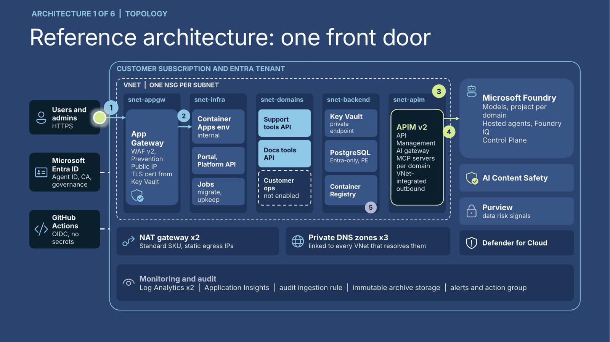
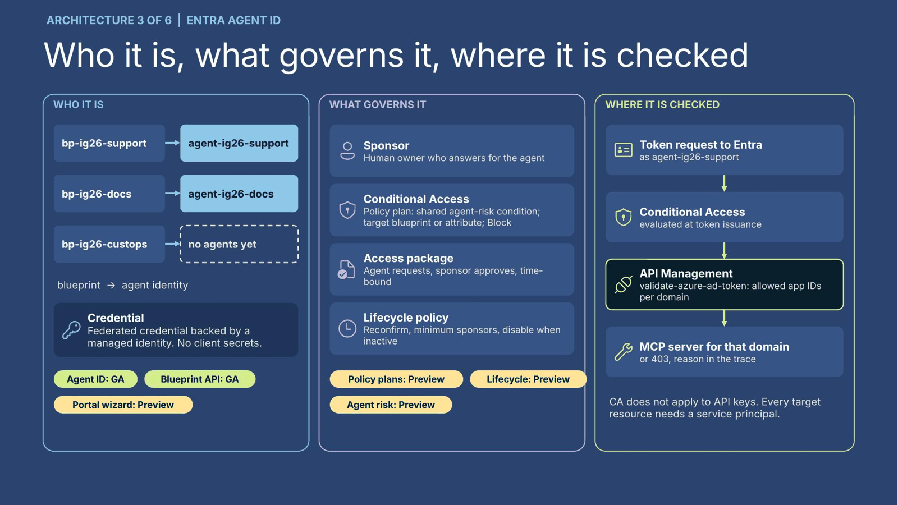
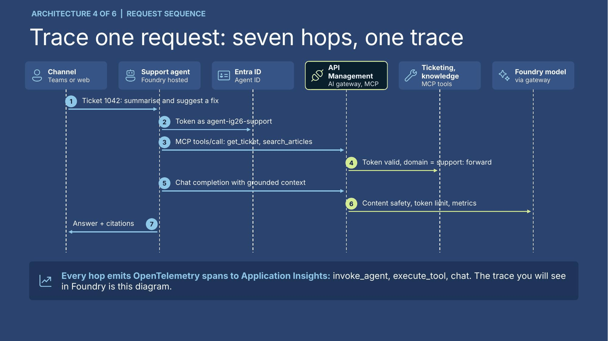
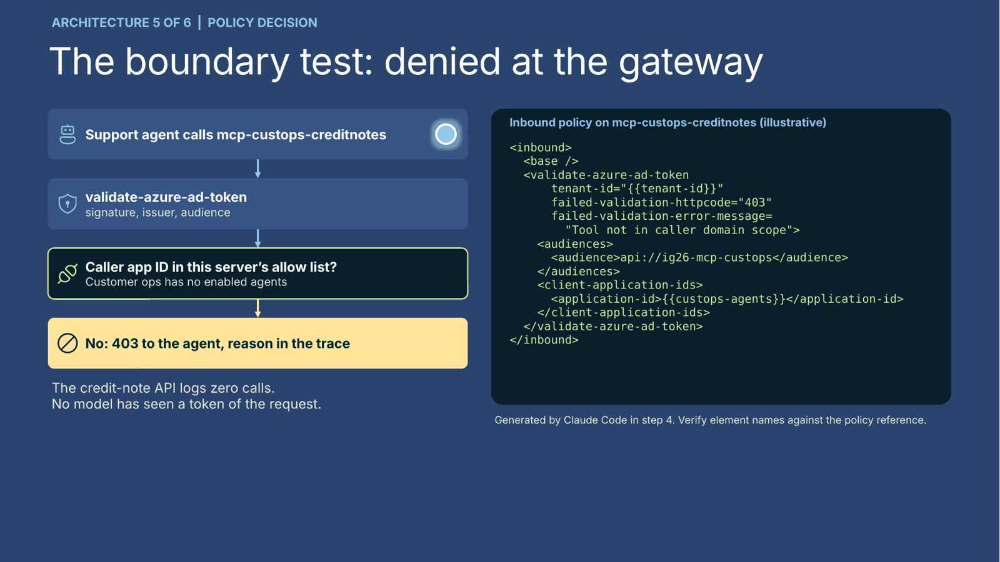
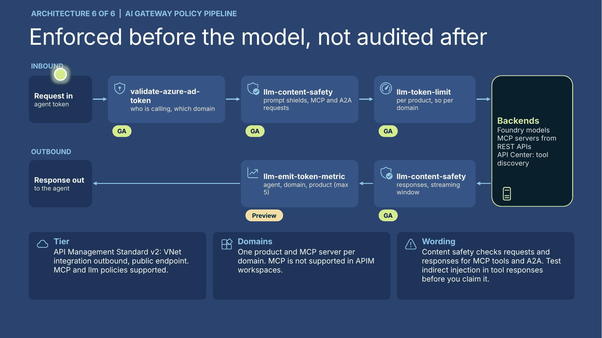
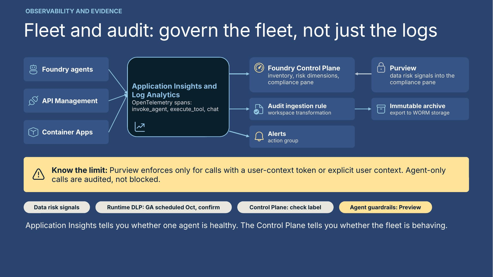

# Many Domain Agents, One Governance Model: an Azure pattern

Companion repository for the Microsoft Ignite 2026 breakout **"Many Domain Agents, One Governance Model: An Azure Pattern"** (level 300) by Emilie Lundblad, Microsoft MVP in AI and Microsoft Regional Director.

Every business unit wants its own agent, and most platforms give each one its own identity, tool access and blind spots. This repo deploys a working reference of **one governance model across many domain agents**, in your own subscription and tenant:

- one governed entry at the **Azure API Management AI gateway**, for models and for tools
- per-domain agents in **Microsoft Foundry**, each with its own **Microsoft Entra agent identity**
- brokered tool access through **governed MCP**: the agent's identity and its domain app role decide which tools it may call, and **content safety** checks tool arguments
- token budgets and token metrics **per domain**, traces in Application Insights, the fleet in **Foundry Control Plane**

Three domains are modelled: **Support** and **Documentation** (enabled, each with an agent) and **Customer operations** (its credit-note backend and MCP server exist, but there is no agent and no other domain may reach it).

> **Status:** demo and learning material, not a production landing zone. Several capabilities used here are in preview; see [status notes](#status-notes). Use a lab subscription and tenant. What CI checks on every change, and what only a live run can prove, is in [docs/validation.md](docs/validation.md).

## Architecture

| | |
|---|---|
|  |  |
| **Reference topology.** One governed entry; internal runtime. | **Identity.** One blueprint per domain project, an identity per agent, app roles on the gateway. |
|  |  |
| **Request sequence.** Seven hops, one trace. | **Boundary test.** Support asks for a Customer ops tool and is denied at the gateway. |
|  |  |
| **AI gateway policy pipeline.** Enforced before the model. | **Fleet and audit.** Control Plane, traces, logs. |

What `azd up` deploys (one resource group, `rg-ig26-<env>`):

| Layer | Resources |
|---|---|
| Network | VNet with an NSG per subnet, Standard NAT gateway, Private DNS zones |
| AI gateway | API Management **Standard v2**, outbound VNet integration; 3 MCP servers, 3 REST APIs, 2 model routes, a shared policy fragment |
| Agents and models | Foundry account (keys disabled), projects `support`, `docs`, `custops`, one model deployment, Content Safety (keys disabled) |
| Runtime | Container Apps environment, **internal**, workload profiles; three mock line-of-business APIs |
| Data and secrets | Key Vault (RBAC, purge protection, private endpoint, no public access), Container Registry (admin user off) |
| Monitoring | Log Analytics, Application Insights, diagnostic settings, optional alerts |
| Optional | Application Gateway WAF_v2 in Prevention mode in front of API Management (`ENABLE_APP_GATEWAY=true`, needs your own domain and certificate) |

Entra objects, created by the `preprovision` hook with your own rights: one app registration `ig26-mcp-gateway-<env>` with three application-only app roles and **assignment required**, and app role assignments to the two agent identities. Foundry creates the agent identity blueprints and agent identities itself.

## Prerequisites

- An Azure subscription where you are **Owner**, or **Contributor plus Role Based Access Control Administrator** (the template creates role assignments for managed identities).
- In Entra ID: permission to **register an application** (the default for members unless an admin turned it off; otherwise the Application Developer role) and to **assign app roles to service principals** (as owner of the app it creates, or with Cloud Application Administrator). If you cannot, an admin can do the two Entra steps for you: see [identity/README.md](identity/README.md).
- Model quota: `gpt-4.1-mini` GlobalStandard, 50K tokens per minute, in your region. Change it with `azd env set MODEL_NAME ...` and `MODEL_VERSION`.
- A region with API Management Standard v2, Container Apps workload profiles and Foundry Agent Service. Default: **Sweden Central**.
- Tools: [Azure Developer CLI](https://aka.ms/azd-install) (azd), [Azure CLI](https://learn.microsoft.com/cli/azure/install-azure-cli), Python 3.10 or later. No local Docker: images build in your registry.
- Cost: roughly USD 30 per day while deployed, most of it API Management Standard v2. Check the [pricing calculator](https://azure.microsoft.com/pricing/calculator/) for your region, and tear down when you are done.

Conditional Access for agents and the agent risk condition need extra licences (Entra ID P1 or P2, and Agent 365 per the Learn page). They are not needed to deploy or to run demos 2 and 3.

## Quick start

```bash
git clone https://github.com/<your-account>/ignite26-many-domain-agents.git
cd ignite26-many-domain-agents
azd auth login
az login                                   # used by the teardown script
azd env new ig26lab --location swedencentral
azd up                                     # 30 to 45 minutes, API Management takes longest
```

`azd up` runs, in order: the `preprovision` hook (Entra gateway app), Bicep provisioning, remote image builds and deploys, and the `postdeploy` hook, which creates `support-agent` and `docs-agent`, waits for their agent identities and grants each one its domain app roles.

Then run the demos with the virtual environment the hook created:

```bash
# macOS / Linux
.venv/bin/python -m agents.run_demo2
.venv/bin/python -m agents.run_demo3
.venv/bin/python -m identity.run_demo1
# Windows
.venv\Scripts\python -m agents.run_demo2
```

App role assignments can take a few minutes to reach new agent tokens. If the first run of demo 2 shows the Support tools denied too, wait five minutes and run it again. Other problems: [docs/troubleshooting.md](docs/troubleshooting.md).

## The demos

| Demo | What it shows | How |
|---|---|---|
| 1. Per-domain identities | Agent identities and blueprints per domain, sponsors, app roles on the gateway, Conditional Access in report-only, lifecycle | `python -m identity.run_demo1` with the portal steps in [docs/demo-1-runbook.md](docs/demo-1-runbook.md) (sponsors and Conditional Access are prepared by hand once) |
| 2. Trace one request, then break a boundary | Support answers ticket 1042 with cited articles through governed MCP; the same agent is denied the Customer ops credit-note tool at the gateway; ticket 1043's planted instruction is treated as data | `python -m agents.run_demo2` |
| 3. Gateway policy and the fleet | 401 without a token, content safety on a tool argument, a per-domain token budget (Support gets 429, Documentation does not), token metrics per domain, the fleet in Foundry Control Plane | `python -m agents.run_demo3` |

## How the boundary works

1. Foundry gives each agent its own Entra agent identity. The MCP connections in each project authenticate as that identity (`AgenticIdentityToken`) with the audience `api://<gateway app id>`.
2. The gateway app has **assignment required** on, so an agent identity gets a token only if it holds one of the app roles: `Support.Tools`, `Docs.Tools`, `CustOps.Tools`.
3. `support-agent` holds `Support.Tools` and `Docs.Tools`. `docs-agent` holds `Docs.Tools`. Nobody holds `CustOps.Tools`.
4. Every MCP server, and the REST API behind it, runs the policy fragment [`ig26-authorize-agent`](infra/policies/fragment-authorize-agent.xml): validate the token, require the domain's role, otherwise return 403 with a reason, a trace record and a metric. The backend never sees a denied call.
5. Model calls take the same road: each project reaches its model through its own route in API Management (`models/support`, `models/docs`) with content safety, a token budget and token metrics.

Granting or removing access is an app role assignment, not a code change: `python -m identity.assign_agent_roles --principal <id> --role Docs.Tools [--revoke]`.

## Security design

The pattern follows the [Microsoft cloud security benchmark](https://learn.microsoft.com/security/benchmark/azure/overview) as far as a lab allows. Details and the trade-offs are in [docs/security.md](docs/security.md).

- **No keys or secrets.** Local auth is disabled on Foundry and Content Safety; the registry admin user is off; Key Vault uses RBAC; API Management calls backends with its managed identity; GitHub deploys with OIDC; the gateway app has no credentials.
- **Least privilege.** Every role assignment is a narrow built-in role on a single resource. The optional GitHub deploy identity can assign only five named roles, and only to service principals.
- **Private runtime.** The Container Apps environment is internal; Key Vault has no public network access; an NSG on every subnet; egress through a NAT gateway; TLS 1.0 and 1.1 off on the gateway.
- **Policy before the model.** Token validation, domain authorisation, Prompt Shields and harm categories, token budgets.
- **Supply chain.** Hash-pinned Python dependencies, actions pinned to full commit SHAs, Dependabot, CodeQL, dependency review, non-root containers.
- **Fake data only.**

## Repository layout

| Path | What |
|---|---|
| `infra/` | Bicep (`main.bicep`, modules, API Management policies); optional GitHub deploy identity in `infra/bootstrap/` |
| `apps/` | Three mock line-of-business APIs (FastAPI) with tests and curated OpenAPI documents |
| `agents/` | Agent setup and demo scripts (Foundry Agent Service, `azure-ai-projects`) |
| `identity/` | Entra gateway app, app role assignments, read-only identity report |
| `scripts/` | azd hooks and teardown |
| `tests/` | Offline tests for the scripts and the policy files |
| `prompts/` | The prompts used to build this with Claude Code and GitHub Copilot, for rebuilding or extending it |
| `docs/` | Walkthrough, troubleshooting, security notes, GitHub deploy, recording runbook |

## Tear down

```bash
python scripts/teardown.py
```

It shows the plan and asks you to type the environment name. It runs `azd down`, purges the soft-deleted Foundry, Content Safety and API Management instances, and deletes the gateway app registration. Key Vault stays soft-deleted for 7 days (purge protection).

## Status notes

Checked 15 November 2026 against Microsoft Learn. Re-check before you rely on any of these.

| Capability | Status |
|---|---|
| Microsoft Entra Agent ID | GA |
| Foundry agent identity per agent; MCP tool authentication with agent identity | Documented (Learn, updated 4 Nov 2026) |
| API Management MCP servers from REST APIs on Standard v2 | Supported; not in workspaces; tools only |
| `llm-content-safety` for MCP | GA |
| `llm-emit-token-metric` | Preview |
| Foundry Control Plane | No GA label on Learn |
| Conditional Access targeting agents; agent risk | Agent entry labelled preview; agent risk preview |
| Conditional Access policy plans | Preview (4 Nov 2026) |
| Agent ID lifecycle policies | Preview |

Known limits: Purview enforces only for calls with a user context; agent-only calls are audited. `mcpTools` and the `AgenticIdentityToken` and `ProjectManagedIdentity` connection types are accepted by the service but missing from the Bicep type definitions, so those warnings are suppressed with a comment. Threat to know: [BluePhishing](https://www.proofpoint.com/us/blog/threat-insight/BluePhishing-Initial-Access-via-Third-Party-Agent-Blueprint-Consent).

## Learn more

- [Agent identity concepts in Microsoft Foundry](https://learn.microsoft.com/azure/foundry/agents/concepts/agent-identity)
- [MCP tool authentication in Foundry](https://learn.microsoft.com/azure/foundry/agents/how-to/mcp-authentication)
- [Expose a REST API as an MCP server](https://learn.microsoft.com/azure/api-management/export-rest-mcp-server)
- [Secure access to MCP servers](https://learn.microsoft.com/azure/api-management/secure-mcp-servers)
- [AI gateway capabilities in API Management](https://learn.microsoft.com/azure/api-management/genai-gateway-capabilities)
- [Conditional Access for agent identities](https://learn.microsoft.com/entra/identity/conditional-access/agent-id)
- [Conditional Access policy plans](https://learn.microsoft.com/entra/identity/conditional-access/concept-conditional-access-policy-plans)
- [Agent ID lifecycle policies](https://learn.microsoft.com/entra/id-governance/agent-lifecycle-policies)
- [Foundry Control Plane overview](https://learn.microsoft.com/azure/foundry/control-plane/overview)
- [Azure-Samples/AI-Gateway](https://github.com/Azure-Samples/AI-Gateway) and [microsoft-foundry/foundry-samples](https://github.com/microsoft-foundry/foundry-samples), whose patterns several modules follow

## A packaged alternative

The session also shows Fortytwo AI Universe, which assembles the same Microsoft products into this pattern and is available on Microsoft Marketplace. It is not part of this repository. Disclosure: the author is a board member of Fortytwo.

## Contributing and security

Issues and pull requests are welcome. Do not include secrets, tenant identifiers or real customer data. To report a security issue, see [SECURITY.md](SECURITY.md).

## License

[MIT](LICENSE)
